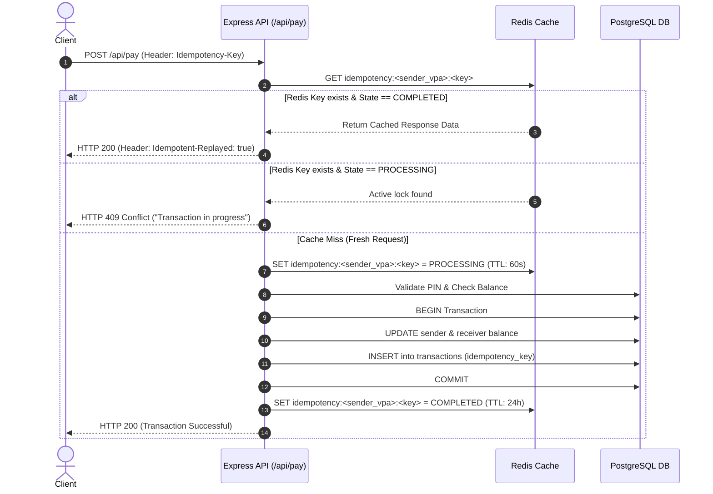

# UPI Full-Stack Wallet & Payment System

A production-grade Unified Payments Interface (UPI) wallet simulation built with **Node.js**, **Express**, **PostgreSQL**, **Redis**, and **React 19**. The application features atomic balance transactions, distributed idempotency controls to prevent double-spending, token blacklisting with Redis, and a modern web dashboard.

---

## Table of Contents
- [Architecture & Tech Stack](#architecture--tech-stack)
- [Key Features](#key-features)
- [Project Structure](#project-structure)
- [Database Schema](#database-schema)
- [API Reference](#api-reference)
  - [Authentication Routes](#authentication-routes)
  - [Wallet & Transaction Routes](#wallet--transaction-routes)
- [Idempotency & Concurrency Control](#idempotency--concurrency-control)
- [Environment Configuration](#environment-configuration)
- [Getting Started](#getting-started)
  - [Option A: Running with Docker Compose (Recommended)](#option-a-running-with-docker-compose-recommended)
  - [Option B: Running Locally (Manual Setup)](#option-b-running-locally-manual-setup)
- [Testing the Payment Workflow](#testing-the-payment-workflow)
- [License](#license)

---

## Architecture & Tech Stack

```
+-----------------------------------------------------------+
|                   React 19 SPA (Vite)                     |
|           Dashboard, Transfers, Deposits, PIN Mgmt         |
+-----------------------------+-----------------------------+
                              | HTTP / JSON (Port 8080 / 5173)
                              v
+-----------------------------------------------------------+
|                   Express.js REST API                     |
|         Auth Middleware (JWT), Routes & Controllers       |
+--------------+-----------------------------+--------------+
               |                             |
     Redis In-Memory Cache            PostgreSQL 16 DB
     (Port 6379)                      (Port 5432)
     - JWT Blacklist (Logout)         - Users & Balances
     - VPA Existence Cache            - Hashed UPI PINs
     - Idempotency Locks (TTL 60s)    - Transaction Ledger
     - Cached Responses (TTL 24h)     - ACID Transactions
```

| Layer | Technology | Description |
|---|---|---|
| **Frontend** | React 19, Vite 8, CSS3 | Single-page application with responsive glassmorphism UI |
| **Backend** | Node.js, Express 5 | RESTful API server handling payments, auth, and business logic |
| **Database** | PostgreSQL 16 | Relational store with ACID transactions and constraints |
| **Cache & Locks** | Redis 7 (Alpine) | In-memory token blacklist, VPA cache, and distributed locks |
| **Security** | bcrypt, jsonwebtoken | Password/PIN hashing with salt rounds and JWT session tokens |
| **DevOps** | Docker, Docker Compose, Nginx | Multi-container orchestrated environment with automated health checks |

---

## Key Features

1. **Authentication & Session Invalidation**:
   - User registration auto-generates unique Virtual Payment Addresses (`<username>@upi`).
   - Secure password storage using `bcrypt` (10 salt rounds).
   - 1-hour expiration JWT authentication tokens.
   - Instant token invalidation upon logout using a Redis blacklist (`blacklist:<token>`).

2. **ACID-Compliant Transactions**:
   - Balance transfers wrapped in database transactions (`BEGIN`, `UPDATE`, `INSERT`, `COMMIT`, `ROLLBACK`).
   - Row updates ensure consistency: sender is debited and receiver is credited simultaneously.
   - Insufficient balance checks prevent overdrafts.

3. **Distributed Idempotency (Double-Spend Protection)**:
   - Supports `Idempotency-Key` / `X-Idempotency-Key` headers or request body payload.
   - Redis temporary distributed lock (`PROCESSING`, 60-second TTL) stops duplicate in-flight requests.
   - Successful responses cached (`COMPLETED`, 24-hour TTL). Retried requests receive cached results with header `Idempotent-Replayed: true`.
   - On business errors (invalid PIN, low balance), locks are cleared immediately to permit retries.

4. **Security & PIN Management**:
   - Independent 4-to-6 digit UPI PINs hashed separately from account passwords.
   - Ability to verify PIN existence (`GET /api/haspin`).
   - Secure PIN update endpoint (`PUT /api/pin`) requiring validation via either previous PIN or master account password.

5. **Wallet Top-Up (Simulated Bank Deposit)**:
   - Dedicated deposit route (`POST /api/deposit`) allowing users to add mock funds from `mock_bank@upi`.

6. **Performance Optimization**:
   - Redis VPA caching (`vpa:<vpa>`) reduces redundant PostgreSQL read queries before executing payments.

---

## Project Structure

```
upi-project/
├── .env.example              # Template environment variables
├── docker-compose.yml        # Multi-container orchestration (api, db, redis, frontend)
├── Dockerfile                # Production Node.js API container specification
├── init.sql                  # PostgreSQL database initialization schema
├── db.js                     # pg Pool database connection configuration
├── redis.js                  # Redis client connection and error handling
├── server.js                 # Express application entry point & route definitions
├── package.json              # Backend dependencies and scripts
├── IDEMPOTENCY.md            # In-depth architectural documentation on idempotency
│
├── middleware/
│   └── auth.js               # JWT verification & Redis blacklist validator
│
├── routes/
│   ├── auth.js               # Signup, login, and logout endpoints
│   └── transaction.js        # Pay, deposit, balance, history, and PIN handlers
│
└── frontend/
    ├── Dockerfile            # Multi-stage build (Vite build + Nginx alpine)
    ├── package.json          # Frontend dependencies (React 19, Vite)
    ├── vite.config.js        # Vite bundler configuration
    ├── index.html            # Main HTML document
    └── src/
        ├── api.js            # Client-side API fetch client with idempotency keys
        ├── App.jsx           # Root view switcher (Auth vs Dashboard)
        ├── main.jsx          # React DOM entry point
        ├── index.css         # Design tokens, typography, and theme styling
        └── components/
            ├── Auth.jsx      # Login and signup forms
            └── Dashboard.jsx # Wallet dashboard, money transfer, deposits & PIN manager
```

---

## Database Schema

Defined in `init.sql`:

### 1. `users` Table
Stores account credentials, user identities, and live wallet balances.
```sql
CREATE TABLE IF NOT EXISTS users (
    id SERIAL,
    username VARCHAR(50) NOT NULL,
    vpa VARCHAR(50) NOT NULL,
    balance DECIMAL(10,2) DEFAULT 0.00,
    password VARCHAR(256) NOT NULL,
    CONSTRAINT users_pk PRIMARY KEY (username),
    CONSTRAINT vpa_uk UNIQUE (vpa)
);
```

### 2. `upi` Table
Stores hashed transaction PINs mapped to user VPAs.
```sql
CREATE TABLE IF NOT EXISTS upi (
    vpa VARCHAR(50) REFERENCES users(vpa) ON DELETE CASCADE,
    pin VARCHAR(256)
);
```

### 3. `transactions` Table
Maintains an immutable audit ledger of all wallet transactions.
```sql
CREATE TABLE IF NOT EXISTS transactions (
    id SERIAL PRIMARY KEY,
    sender_vpa VARCHAR(50) NOT NULL,
    receiver_vpa VARCHAR(50) NOT NULL,
    amount DECIMAL(10, 2) NOT NULL,
    category VARCHAR(20),
    status VARCHAR(20) DEFAULT 'SUCCESS',
    idempotency_key VARCHAR(100),
    timestamp TIMESTAMP DEFAULT CURRENT_TIMESTAMP
);
```

---

## API Reference

### Base URL
```
http://localhost:3000
```

### Authentication Header
Protected endpoints require a JSON Web Token passed in the `Authorization` header:
```
Authorization: Bearer <your_jwt_token>
```

---

### Authentication Routes

#### 1. Register User
- **Endpoint**: `POST /api/auth/signup`
- **Description**: Creates a new user profile, derives their VPA (`<username>@upi`), and initializes their wallet with a `0.00` balance.
- **Request Body**:
  ```json
  {
    "username": "alice",
    "password": "Password123"
  }
  ```
- **Responses**:
  - `201 Created`:
    ```json
    {
      "message": "User created!",
      "user": {
        "id": 1,
        "username": "alice",
        "vpa": "alice@upi"
      }
    }
    ```
  - `500 Internal Server Error`:
    ```json
    {
      "error": "duplicate key value violates unique constraint \"users_pk\""
    }
    ```

#### 2. User Login
- **Endpoint**: `POST /api/auth/login`
- **Description**: Validates user credentials and issues a signed JWT valid for 1 hour.
- **Request Body**:
  ```json
  {
    "username": "alice",
    "password": "Password123"
  }
  ```
- **Responses**:
  - `200 OK`:
    ```json
    {
      "message": "Login Successful",
      "token": "eyJhbGciOiJIUzI1NiIsInR5cCI6IkpXVCJ9..."
    }
    ```
  - `400 Bad Request`:
    ```json
    {
      "error": "Invalid Password"
    }
    ```

#### 3. User Logout
- **Endpoint**: `POST /api/auth/logout`
- **Description**: Invalidates the current session token by adding it to the Redis token blacklist with an expiry of 3600 seconds.
- **Headers**:
  ```
  Authorization: Bearer <token>
  ```
- **Response**:
  - `200 OK`:
    ```json
    {
      "message": "Logged out successfully"
    }
    ```

---

### Wallet & Transaction Routes

All routes below require `Authorization: Bearer <token>`.

#### 1. Check PIN Status
- **Endpoint**: `GET /api/haspin`
- **Description**: Checks whether the authenticated user has already configured a UPI PIN.
- **Response**:
  - `200 OK`:
    ```json
    {
      "hasPin": true
    }
    ```

#### 2. Create UPI PIN
- **Endpoint**: `POST /api/createpin`
- **Description**: Sets the initial UPI PIN for transactions. Fails if a PIN already exists for the account.
- **Request Body**:
  ```json
  {
    "pin": "1234"
  }
  ```
- **Responses**:
  - `200 OK`:
    ```json
    {
      "message": "Pin created successfully..."
    }
    ```
  - `400 Bad Request`:
    ```json
    {
      "error": "user already exists"
    }
    ```

#### 3. Update UPI PIN
- **Endpoint**: `PUT /api/pin`
- **Description**: Updates an existing UPI PIN. Requires verification either through `oldPin` or the account `password`.
- **Request Body (Option A - Verify via Old PIN)**:
  ```json
  {
    "newPin": "5678",
    "oldPin": "1234"
  }
  ```
- **Request Body (Option B - Verify via Account Password)**:
  ```json
  {
    "newPin": "5678",
    "password": "Password123"
  }
  ```
- **Responses**:
  - `200 OK`:
    ```json
    {
      "message": "PIN updated successfully"
    }
    ```
  - `400 Bad Request`:
    ```json
    {
      "error": "Incorrect old PIN"
    }
    ```

#### 4. Deposit Funds (Mock Bank Top-up)
- **Endpoint**: `POST /api/deposit`
- **Description**: Credits funds to the authenticated user's wallet from `mock_bank@upi` and logs a deposit record.
- **Request Body**:
  ```json
  {
    "amount": 1000.00
  }
  ```
- **Responses**:
  - `200 OK`:
    ```json
    {
      "message": "Deposit successful"
    }
    ```
  - `400 Bad Request`:
    ```json
    {
      "error": "Invalid amount"
    }
    ```

#### 5. Send Payment
- **Endpoint**: `POST /api/pay`
- **Description**: Transfers funds to another VPA atomically with PIN verification and idempotency protection.
- **Optional Headers**:
  - `Idempotency-Key`: Unique UUID string (recommended)
  - `X-Idempotency-Key`: Alternative key header
- **Request Body**:
  ```json
  {
    "receiver_vpa": "bob@upi",
    "amount": 250.00,
    "category": "Groceries",
    "pin": "1234",
    "idempotency_key": "optional-uuid-in-body"
  }
  ```
- **Responses**:
  - `200 OK` (Standard execution):
    ```json
    {
      "success": true,
      "message": "Transaction Successful",
      "transaction_id": 14
    }
    ```
  - `200 OK` (Idempotent replay from Redis cache):
    - *Headers*: `Idempotent-Replayed: true`
    ```json
    {
      "success": true,
      "message": "Transaction Successful",
      "transaction_id": 14
    }
    ```
  - `409 Conflict` (In-flight concurrent request with identical key):
    ```json
    {
      "error": "A transaction with this idempotency key is currently being processed"
    }
    ```
  - `400 Bad Request`:
    ```json
    {
      "error": "Insufficient balance 😒"
    }
    ```

#### 6. Check Wallet Balance
- **Endpoint**: `GET /api/balance`
- **Description**: Fetches current available balance for the authenticated user.
- **Response**:
  - `200 OK`:
    ```json
    {
      "balance": 750.00
    }
    ```

#### 7. Transaction History
- **Endpoint**: `GET /api/history`
- **Description**: Retrieves all transactions (both sent and received) for the current user, ordered chronologically newest first.
- **Response**:
  - `200 OK`:
    ```json
    {
      "transactions": [
        {
          "id": 14,
          "sender_vpa": "alice@upi",
          "receiver_vpa": "bob@upi",
          "amount": "250.00",
          "category": "Groceries",
          "status": "SUCCESS",
          "idempotency_key": "3f9c6d12-...",
          "timestamp": "2026-10-12T15:05:00.000Z"
        },
        {
          "id": 13,
          "sender_vpa": "mock_bank@upi",
          "receiver_vpa": "alice@upi",
          "amount": "1000.00",
          "category": "Deposit",
          "status": "SUCCESS",
          "idempotency_key": null,
          "timestamp": "2026-10-12T14:50:00.000Z"
        }
      ]
    }
    ```

---

## Idempotency & Concurrency Control

In payment systems, network retries or double-clicks must never result in duplicate debiting. This project implements a robust Redis distributed lock pattern:



See [IDEMPOTENCY.md](file:///d:/upi-project/IDEMPOTENCY.md) for full details on testing idempotency via cURL.

---

## Environment Configuration

Create a `.env` file in the root directory. You can copy the template:

```bash
cp .env.example .env
```

### Environment Variables

| Variable | Description | Local Value (`node server.js`) | Docker Value (`docker-compose`) |
|---|---|---|---|
| `DB_HOST` | PostgreSQL Host | `localhost` | `postgres_db` (service name) |
| `DB_PORT` | PostgreSQL Port | `5432` | `5432` |
| `DB_USER` | PostgreSQL Username | `postgres` | `postgres` |
| `DB_PASSWORD` | PostgreSQL Password | `admin` | `admin` |
| `DB_NAME` | PostgreSQL Database Name | `upi_project` | `upi_project` |
| `REDIS_HOST` | Redis Host | `localhost` | `redis_cache` (service name) |
| `REDIS_PORT` | Redis Port | `6379` | `6379` |
| `JWT_SECRET` | Secret key for signing JWTs | Any secure random string | Any secure random string |

---

## Getting Started

### Option A: Running with Docker Compose (Recommended)

Docker Compose automatically spins up the Node.js API, PostgreSQL database with schema pre-loaded, Redis cache, and the React frontend with Nginx.

1. Ensure Docker Desktop is installed and running.
2. In the project root, run:
   ```bash
   docker-compose up --build
   ```
3. Access the services:
   - **React Frontend**: [http://localhost:8080](http://localhost:8080)
   - **Express API**: [http://localhost:3000](http://localhost:3000)
   - **PostgreSQL**: `localhost:5432`
   - **Redis**: `localhost:6379`

To shut down the containers:
```bash
docker-compose down
```

---

### Option B: Running Locally (Manual Setup)

#### 1. Start Prerequisites (PostgreSQL & Redis)
Ensure you have PostgreSQL and Redis running locally:
```bash
# Example: starting Redis via Docker
docker run -d --name upi-redis -p 6379:6379 redis:alpine

# Example: starting PostgreSQL via Docker
docker run -d --name upi-postgres \
  -e POSTGRES_USER=postgres \
  -e POSTGRES_PASSWORD=admin \
  -e POSTGRES_DB=upi_project \
  -p 5432:5432 \
  -v $(pwd)/init.sql:/docker-entrypoint-initdb.d/init.sql \
  postgres:16-alpine
```

If using a local PostgreSQL installation directly, connect via `psql` and execute the schema:
```bash
psql -U postgres -d upi_project -f init.sql
```

#### 2. Backend Setup
```bash
# In the project root directory
npm install
node server.js
```
The backend API starts on `http://localhost:3000`.

#### 3. Frontend Setup
```bash
cd frontend
npm install
npm run dev
```
The Vite development server starts on `http://localhost:5173`.

---

## Testing the Payment Workflow

Here is a quick walkthrough using `curl`:

1. **Sign Up User A**:
   ```bash
   curl -X POST http://localhost:3000/api/auth/signup \
     -H "Content-Type: application/json" \
     -d '{"username": "alice", "password": "password123"}'
   ```

2. **Sign Up User B**:
   ```bash
   curl -X POST http://localhost:3000/api/auth/signup \
     -H "Content-Type: application/json" \
     -d '{"username": "bob", "password": "password123"}'
   ```

3. **Log in as User A** to obtain a JWT:
   ```bash
   curl -X POST http://localhost:3000/api/auth/login \
     -H "Content-Type: application/json" \
     -d '{"username": "alice", "password": "password123"}'
   # Save the returned token as $TOKEN
   ```

4. **Create UPI PIN for User A**:
   ```bash
   curl -X POST http://localhost:3000/api/createpin \
     -H "Authorization: Bearer <TOKEN>" \
     -H "Content-Type: application/json" \
     -d '{"pin": "9999"}'
   ```

5. **Deposit Funds into User A's Wallet**:
   ```bash
   curl -X POST http://localhost:3000/api/deposit \
     -H "Authorization: Bearer <TOKEN>" \
     -H "Content-Type: application/json" \
     -d '{"amount": 500.00}'
   ```

6. **Transfer Funds from Alice to Bob with Idempotency Key**:
   ```bash
   curl -X POST http://localhost:3000/api/pay \
     -H "Authorization: Bearer <TOKEN>" \
     -H "Idempotency-Key: req_abc123" \
     -H "Content-Type: application/json" \
     -d '{
       "receiver_vpa": "bob@upi",
       "amount": 150.00,
       "category": "Food",
       "pin": "9999"
     }'
   ```

7. **Verify Balance & Transaction History**:
   ```bash
   curl -X GET http://localhost:3000/api/balance \
     -H "Authorization: Bearer <TOKEN>"

   curl -X GET http://localhost:3000/api/history \
     -H "Authorization: Bearer <TOKEN>"
   ```

---

## License

This project is licensed under the [ISC License](file:///d:/upi-project/package.json).